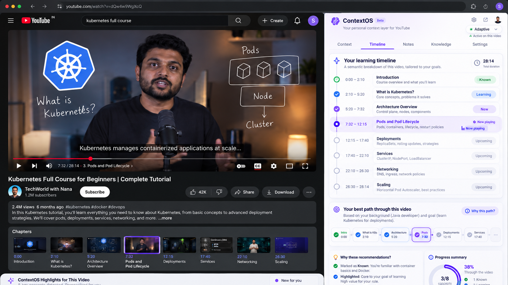
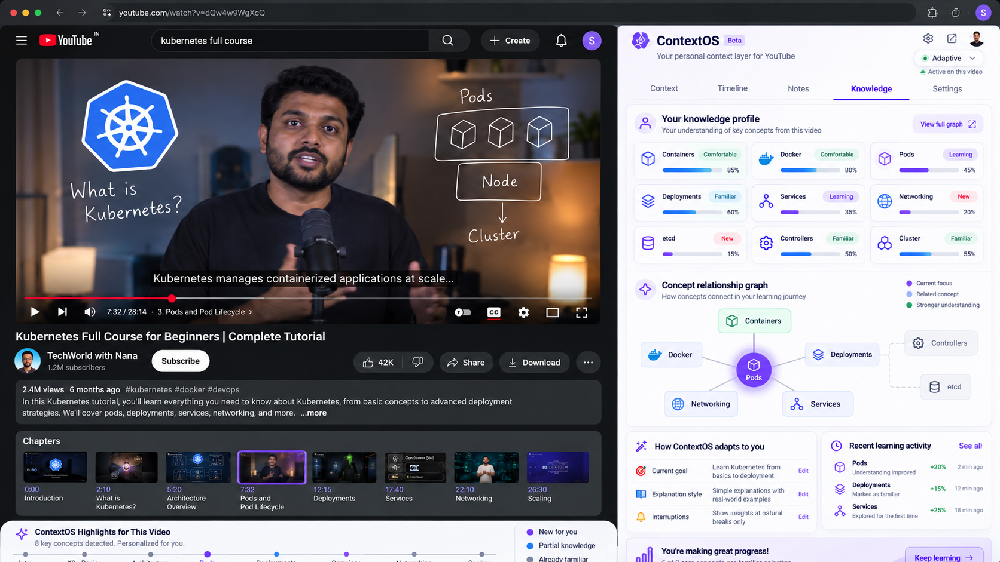
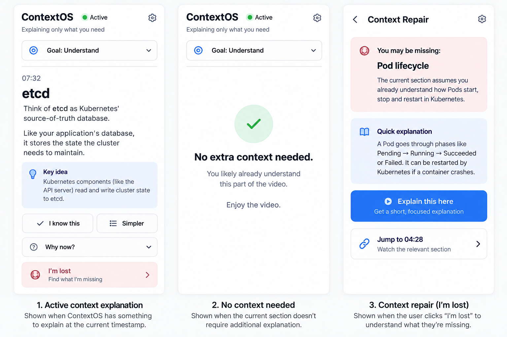

# ContextOS

ContextOS is a personal context layer for YouTube learning.

It watches the current YouTube timestamp, maps it to a generated Context Manifest, compares that concept against the learner's local knowledge profile, and only explains what the learner probably needs right now.



## Why This Exists

Long videos often assume background knowledge. ContextOS adds a lightweight learning layer beside YouTube:

- detects the current YouTube video and timestamp
- generates a semantic timeline of concepts
- stores reusable video context manifests
- keeps a local learner profile in the browser
- decides locally whether to show or stay quiet
- lets each developer bring their own Gemini and Firebase credentials

## Current Status

This is a hackathon prototype, built as a monorepo.

Working today:

- Chrome Manifest V3 extension
- native Chrome side panel
- YouTube watch-page detection, SPA navigation detection, timestamp tracking
- Spring Boot backend
- mock analyzer for zero-secret local development
- optional Gemini analyzer
- optional Firestore manifest persistence
- extension-side Knowledge Delta and Context Policy Engine
- local profile memory with "I know this"

Not done yet:

- Firebase Auth
- shared account login
- Chrome Web Store packaging
- production deployment scripts
- full "I'm lost" context repair flow

## Screenshots

Timeline and policy-driven context:


Knowledge profile concept graph mockup:



Context repair direction:



## Tech Stack

- Extension: Chrome MV3, React, TypeScript, Vite
- Backend: Java 21, Spring Boot, Maven
- AI: Gemini Developer API, optional
- Persistence: in-memory by default, Firestore optional
- Browser storage: `chrome.storage.local` for local learner profile
- Tests: TypeScript policy/profile tests, JUnit backend tests

## Repository Structure

```text
contextos/
  backend/           Spring Boot API, Gemini analyzer, Firestore repository
  extension/         Chrome extension side panel, content script, policy engine
  docs/              Architecture notes, API notes, screenshots
  web/               Future onboarding/settings web app placeholder
```

## Quick Start

Requirements:

- Node.js 20+
- npm
- Java 21+
- Maven
- Chrome

Clone and install:

```bash
git clone https://github.com/YOUR_USERNAME/contextos.git
cd contextos
npm install
```

Build the extension:

```bash
npm run build
```

Run the backend in mock mode:

```bash
cd backend
mvn spring-boot:run
```

Load the extension:

1. Open `chrome://extensions`
2. Enable Developer mode
3. Click Load unpacked
4. Select `contextos/extension/dist`
5. Open a YouTube watch page
6. Open the ContextOS side panel from the extension icon

Mock mode works without Gemini or Firebase credentials.

## Environment Setup

Backend env file:

```bash
cp backend/.env.example backend/.env
```

Extension env file:

```bash
cp extension/.env.example extension/.env
```

The real `.env` files are ignored by git. Do not commit keys.

## Gemini Setup

For real AI analysis, create a Gemini API key in Google AI Studio and update `backend/.env`:

```bash
GOOGLE_API_KEY=your_google_ai_studio_key
CONTEXTOS_GEMINI_ENABLED=true
CONTEXTOS_GEMINI_MODEL=gemini-3.5-flash-lite
```

Restart the backend after changing env values.

## Firestore Setup

Firestore is optional. The backend uses in-memory storage by default.

To use Firestore, create a Firebase or Google Cloud project, enable Firestore, create a service account JSON key, then update `backend/.env`:

```bash
CONTEXTOS_PERSISTENCE=firestore
GOOGLE_CLOUD_PROJECT=your_project_id
GOOGLE_APPLICATION_CREDENTIALS=/absolute/path/to/service-account.json
```

Recommended local key location:

```bash
mkdir -p ~/.config/contextos
mv ~/Downloads/your-service-account.json ~/.config/contextos/firebase-service-account.json
```

Then use:

```bash
GOOGLE_APPLICATION_CREDENTIALS=/Users/YOUR_MAC_USERNAME/.config/contextos/firebase-service-account.json
```

Never commit the service account JSON file.

## Useful Commands

From the repo root:

```bash
npm run build
npm run typecheck
npm test
```

Extension-only tests:

```bash
npm --workspace extension run test
```

Backend-only tests:

```bash
npm --prefix backend test
```

Backend API smoke test:

```bash
curl -s http://127.0.0.1:8080/api/v1/health
```

Analyze a video:

```bash
curl -s -X POST http://127.0.0.1:8080/api/v1/videos/analyze \
  -H 'Content-Type: application/json' \
  -d '{"youtubeUrl":"https://www.youtube.com/watch?v=dQw4w9WgXcQ","title":"Kubernetes Tutorial"}'
```

## How The Policy Works

The extension does not call Gemini for every timestamp.

The backend creates or loads a Context Manifest once per video. The extension then:

1. finds the current segment from playback time
2. checks the primary concept and prerequisites against local profile memory
3. computes a deterministic gap score
4. shows context only if the policy says `SHOW`
5. stays quiet if the learner likely already has enough context

Policy scoring:

```text
Knowledge: UNKNOWN=3, LEARNING=2, FAMILIAR=1, COMFORTABLE=0
Importance: CORE=3, HIGH=2, MEDIUM=1, LOW=0
Prerequisite gap: UNKNOWN=+2, LEARNING=+1
LEARNING threshold: 4
CONTEXTUAL threshold: 6
PASSIVE mode: always silent
```

## Open Source Notes

This repo is designed so contributors can clone and run it with their own credentials.

Commit:

- source code
- docs
- screenshots
- `.env.example`
- `package-lock.json`

Do not commit:

- `.env`
- Firebase service account JSON
- `node_modules`
- `extension/dist`
- `backend/target`
- IDE workspace files

## License

MIT
